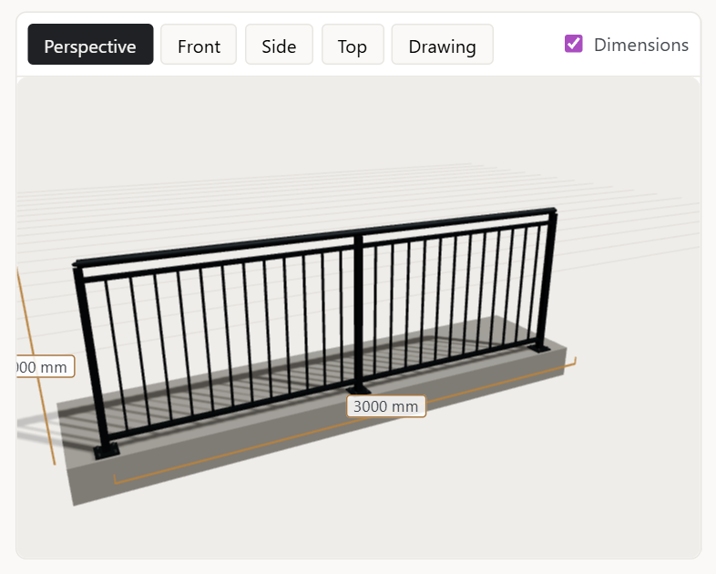
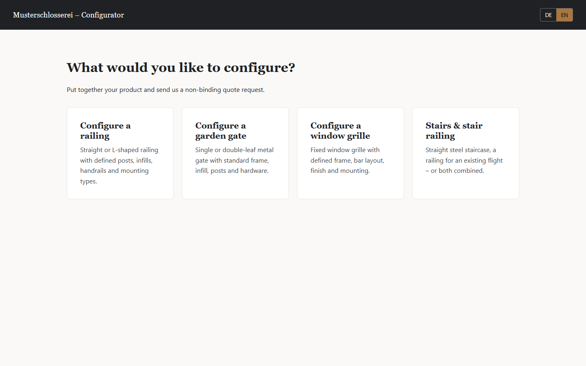
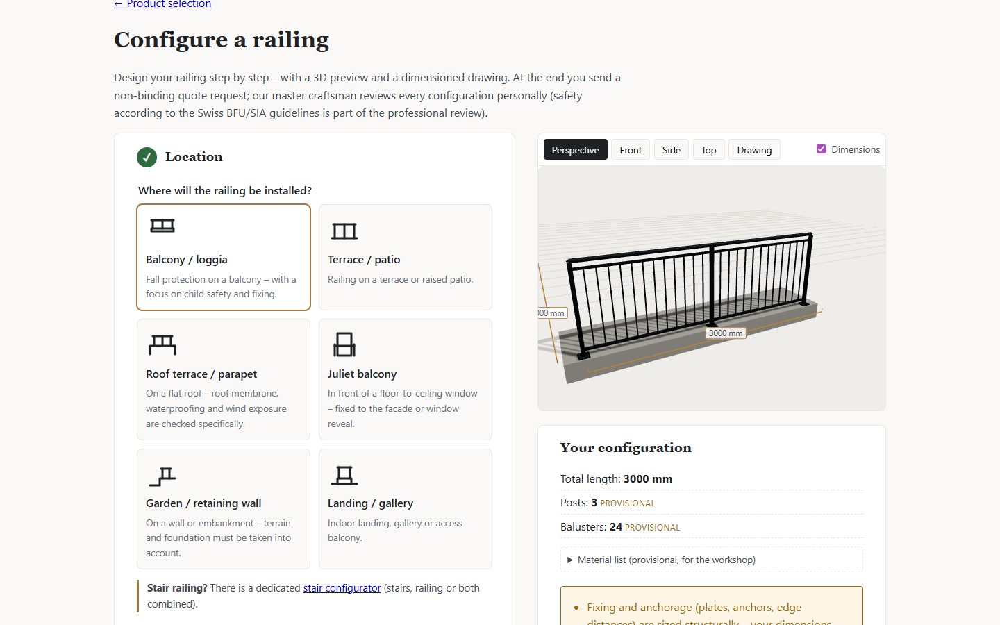
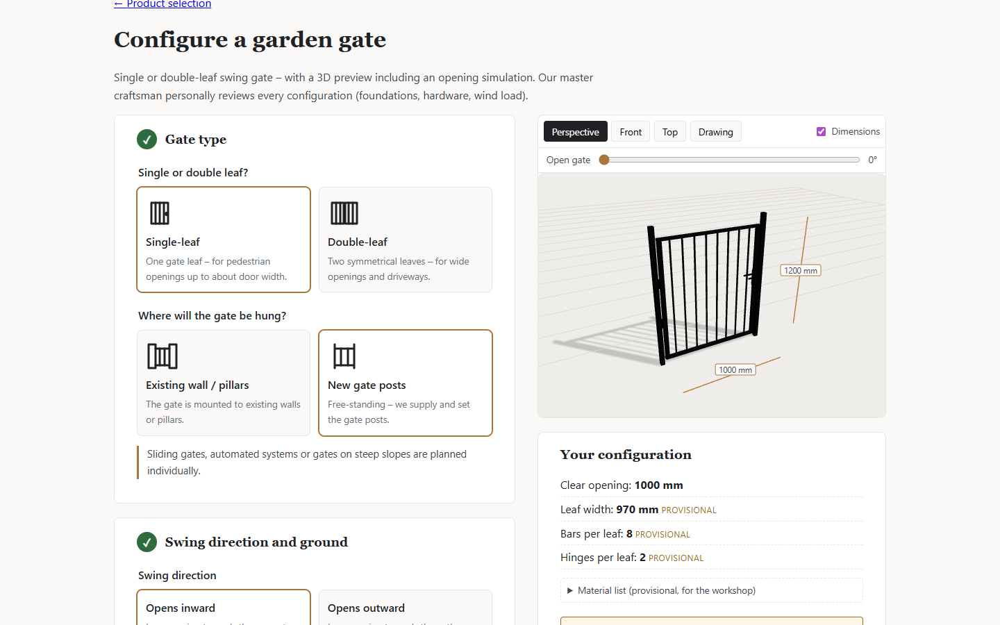
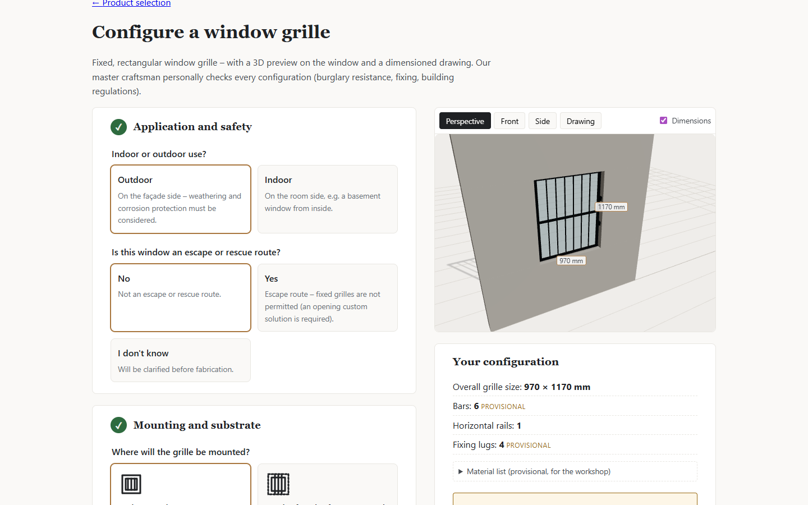
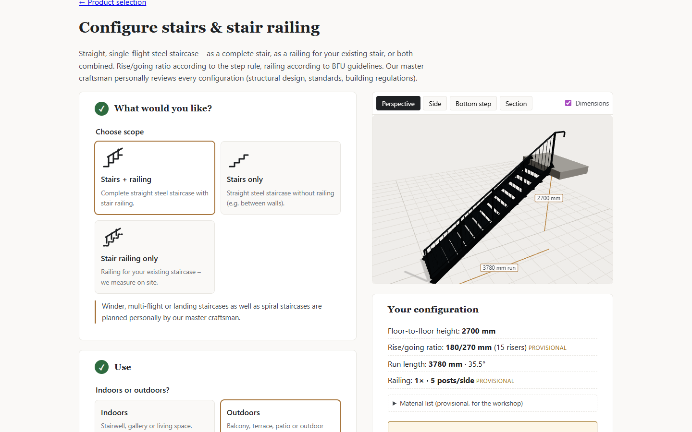
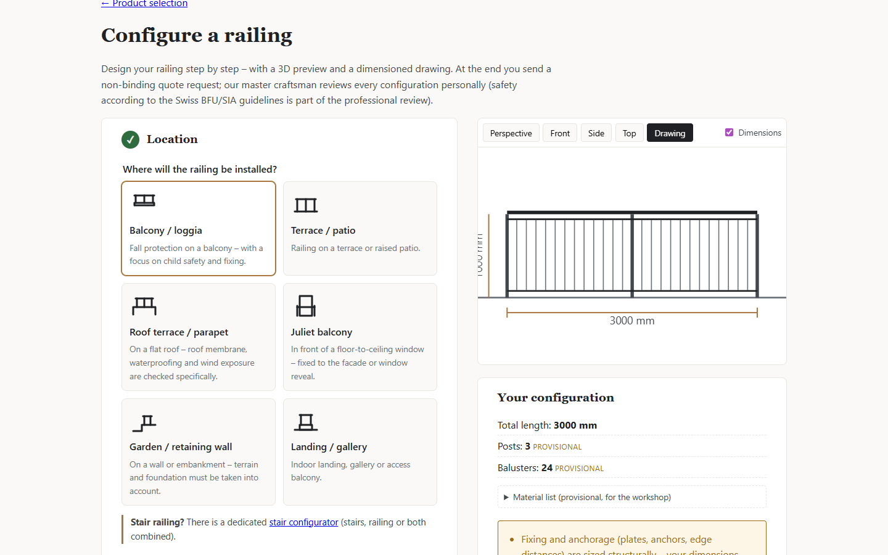
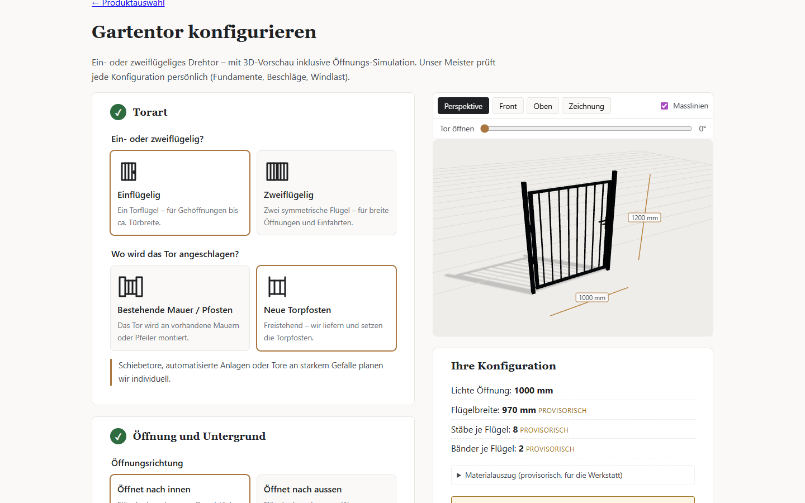
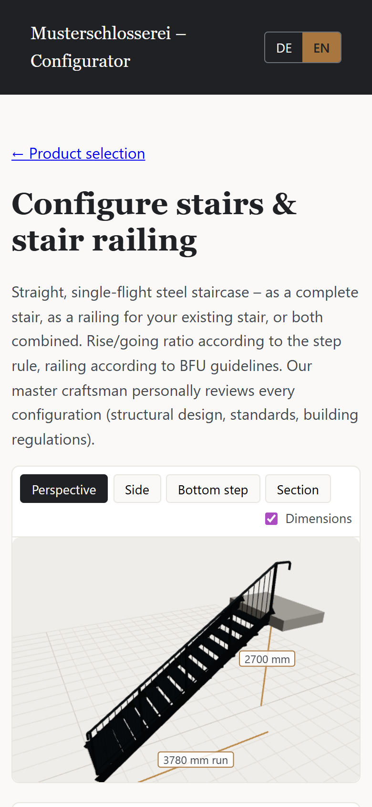

<div align="center">

# ⚒️ WebForge Configurator

### Design railings, garden gates, window grilles and stairs in the browser, in live 3D.

*A web configurator for the art-metalwork trade. It turns "I'd like a railing for my balcony" into a complete, dimensioned request the workshop can quote.*


<br>



</div>

---

## 📖 Table of contents

- [About the project](#-about-the-project)
- [Screenshots](#-screenshots)
- [Features](#-features)
- [Quick start](#-quick-start)
- [How to use it](#-how-to-use-it)
- [Add it to an existing website](#-add-it-to-an-existing-website)
- [Architecture](#-architecture)
- [Translations](#-translations)
- [Development](#-development)
- [Roadmap](#-roadmap)
- [Team](#-team) · [License](#-license)

---

## 👋 About the project

**Michl and I** are building a solution for the customers of a traditional
**art-metalwork and metal-fabrication workshop** (*Kunst- und Metallschlosserei*).

Customers usually arrive with a rough idea like *"a railing for my balcony"* or
*"a gate for the garden"*. They often don't have dimensions, and they rarely know
which options exist. That makes the first contact slow for both sides: several
calls, a site visit, sketches back and forth.

**WebForge** lets customers work out their idea in a guided web tool before
anyone picks up the phone:

1. choose the product and the style,
2. enter the dimensions,
3. watch the design update live in **3D** and as a **dimensioned drawing**,
4. send a clean, complete **quote request** to the workshop.

> [!NOTE]
> The tool does not replace the craftsperson. The workshop still checks every
> configuration by hand and writes the final quote. WebForge just gives the
> first conversation a much better starting point.

---

## 📸 Screenshots

<table>
  <tr>
    <td width="50%"><br><sub><b>Start page.</b> Four product modules.</sub></td>
    <td width="50%"><br><sub><b>Railing.</b> Guided steps on the left, live 3D on the right.</sub></td>
  </tr>
  <tr>
    <td><br><sub><b>Garden gate.</b> Includes an opening simulation slider.</sub></td>
    <td><br><sub><b>Window grille.</b> Shown in the window reveal.</sub></td>
  </tr>
  <tr>
    <td><br><sub><b>Stairs.</b> Step-rule check (2R + G) and a combined stair railing.</sub></td>
    <td><br><sub><b>Drawing view.</b> 2D elevation with dimensions.</sub></td>
  </tr>
  <tr>
    <td><br><sub><b>Bilingual.</b> The same gate in German, one click on <code>DE | EN</code>.</sub></td>
    <td align="center"><br><sub><b>Mobile-first.</b> The whole flow works on a phone.</sub></td>
  </tr>
</table>

---

## ✨ Features

| Module | What customers can configure |
| --- | --- |
| 🏛️ **Railings** | Straight, L or U layout · location (balcony, terrace, roof, Juliet balcony…) · mounting (top-mounted, side-mounted, core-drilled) · posts, handrail, bottom rail · infill (vertical bars, horizontal rails, sheet, mesh, forged ornaments) · handrail ends · material, finish, RAL colour |
| 🚪 **Garden gates** | Single or double leaf · existing wall or new posts · swing direction with **live opening simulation** · infill style · lock and hardware |
| 🪟 **Window grilles** | Window dimensions · reveal or face mounting · bar layout and spacing · ornaments · escape-route check |
| 🪜 **Stairs** | Stairs, stair railing or both · floor-to-floor height and width · stringer or mono-stringer · open or closed risers · grating or checker-plate treads · railing side and infill |

**Across all modules:**

- 🧊 **Parametric 3D preview.** React Three Fiber scene with perspective, front, side and top views, dimension lines and a 2D drawing.
- 🚀 **Ready from the first click.** Every configurator starts with sensible defaults, so a complete 3D model is visible immediately.
- 📐 **Rule engine with traffic lights.** Green, yellow or red feedback based on common Swiss safety guidelines (BFU/SIA): railing height, gap sizes, climbability, step rule and more.
- 🧾 **Material list for the workshop.** A provisional bill of materials is derived from the same model.
- 💬 **Honest pricing.** The tool never invents prices. Until a price model is approved it shows *"individual review"* instead of a fake number.
- 🔗 **Shareable configurations.** Save a configuration as a link and reopen it later.
- 🌐 **German and English.** Switch at any time; the choice is remembered.
- 📱 **Mobile-first and accessible.** Native radio inputs, keyboard navigation, screen-reader labels.
- 🔌 **WordPress plugin.** Drop it into any existing WordPress site with one shortcode.

---

## 🚀 Quick start

**Requirements:** [Node.js](https://nodejs.org/) 20 or newer.

```bash
git clone https://github.com/goallthepath/WebForge-Configurator.git
cd WebForge-Configurator/configurator
npm install
npm run dev
```

Open **http://localhost:5173/konfigurator/**. That's it: no database or backend needed to try the configurator.

---

## 🧭 How to use it

1. **Pick a product** on the start page: railing, garden gate, window grille or stairs.
2. **Work through the steps** on the left. Every step is already filled with a sensible default, so you only change what differs from your situation.
3. **Watch the 3D preview** on the right. Drag to rotate, scroll to zoom, and switch between *Perspective*, *Front*, *Side*, *Top* and *Drawing*. Toggle *Dimensions* to show or hide measurements.
4. **Check the traffic light** in the summary:
   - 🟢 **Green:** everything fits.
   - 🟡 **Yellow:** the workshop needs to check something (for example, limits not yet approved).
   - 🔴 **Red:** the configuration breaks a safety rule; the summary tells you why.
5. **Save or share** your configuration with *Save configuration (link)*.
6. **Switch language** with the `DE | EN` toggle in the header.

> [!TIP]
> Useful URL parameters: `?lang=en` or `?lang=de` forces the language, and `?c=…` opens a saved configuration.

---

## 🔌 Add it to an existing website

There are three ways, from easiest to most flexible.

### Option A: WordPress plugin with shortcode (recommended)

The `webforge-core` plugin ships a shortcode that embeds the configurator on **any page or post** of an existing WordPress site. It runs inside an isolated iframe, so your theme's CSS and the configurator never interfere with each other.

**1. Build the configurator into the plugin**

```bash
cd configurator
npm install
npm run build:wp
```

This writes the finished app to `wordpress/wp-content/plugins/webforge-core/configurator/`.

**2. Install the plugin**

- Zip the folder `wordpress/wp-content/plugins/webforge-core/`, then go to **WordPress admin → Plugins → Add New → Upload Plugin**, *or*
- copy the folder into `wp-content/plugins/` on your server via FTP/SSH.

Then **activate** *WebForge Core* under **Plugins**.

**3. Place the shortcode**

Add a *Shortcode* block (or paste into the classic editor) on any page:

```text
[webforge_configurator]
```

| Attribute | Values | Default | Example |
| --- | --- | --- | --- |
| `product` | `gelaender` (railing), `gartentor` (gate), `fenstergitter` (grille), `treppe` (stairs) | *empty* = product selection | `product="gartentor"` |
| `lang` | `de`, `en` | visitor's last choice, else `de` | `lang="en"` |
| `height` | height in px (400–3000) | `900` | `height="1100"` |

```text
[webforge_configurator product="gelaender" lang="en" height="1000"]
```

> [!NOTE]
> If the build step is missing, editors see a short hint where the shortcode is placed. Regular visitors see nothing, so a page never shows a broken frame.

### Option B: Standalone under `/konfigurator/`

Use this when the configurator should live at its own address on your domain.

```bash
cd configurator
npm run build        # output: configurator/dist/
```

Upload the contents of `configurator/dist/` to the folder `/konfigurator/` in your web root. The app uses clean URLs (`/konfigurator/gelaender/`), so add a fallback rule that serves `index.html` for unknown paths:

<details>
<summary><b>Apache (.htaccess in /konfigurator/)</b></summary>

```apache
RewriteEngine On
RewriteBase /konfigurator/
RewriteCond %{REQUEST_FILENAME} !-f
RewriteCond %{REQUEST_FILENAME} !-d
RewriteRule . /konfigurator/index.html [L]
```

</details>

<details>
<summary><b>nginx</b></summary>

```nginx
location /konfigurator/ {
    try_files $uri $uri/ /konfigurator/index.html;
}
```

</details>

### Option C: Any other website (non-WordPress)

The plugin build from Option A uses relative paths and hash routing, so it runs from **any folder on any web server**. Upload `wordpress/wp-content/plugins/webforge-core/configurator/` anywhere (for example `/tools/webforge/`) and embed it with a plain iframe:

```html
<iframe
  src="/tools/webforge/index.html?lang=en#/gartentor/"
  title="Product configurator"
  style="width:100%; height:900px; border:0"
  loading="lazy">
</iframe>
```

---

## 🏗️ Architecture

```text
┌───────────────────────────────┐        REST (JSON)        ┌────────────────────────────────┐
│  Configurator (SPA)           │ ────────────────────────▶ │  WordPress + webforge-core     │
│  React · TypeScript · R3F     │                           │  post types · REST · shortcode │
└──────────────┬────────────────┘                           └───────────────┬────────────────┘
               │ imports at build time                                      │ renders
┌──────────────▼────────────────┐                           ┌───────────────▼────────────────┐
│  product-data/                │                           │  Block theme `webforge`        │
│  JSON catalogs + schemas      │                           │  website & content             │
└───────────────────────────────┘                           └────────────────────────────────┘
```

Inside the configurator, every module follows the same one-way data flow:

```text
user input ─▶ derive.ts ─▶ *-rules.ts ─▶ estimate.ts ─▶ geometry.ts ─▶ 3D scene + drawing
 (state)     (quantities,   (traffic      (price type)   (meshes, dims)
             material list)  light)
```

| Part | Tech | Location |
| --- | --- | --- |
| Configurator | React 19, TypeScript, React Three Fiber, Vite, Vitest | [`configurator/`](configurator/) |
| Product modules | Inputs, derived values, geometry per product | [`configurator/src/products/`](configurator/src/products/) |
| Rule engine | Safety and plausibility rules per product | [`configurator/src/rules/`](configurator/src/rules/) |
| 3D viewers | Scenes and viewers per product | [`configurator/src/viewer/`](configurator/src/viewer/) |
| Translations | German source text → English dictionaries | [`configurator/src/i18n/`](configurator/src/i18n/) |
| WordPress plugin | Post types, REST API, shortcode | [`wordpress/wp-content/plugins/webforge-core/`](wordpress/wp-content/plugins/webforge-core/) |
| Website theme | WordPress block theme | [`wordpress/wp-content/themes/webforge/`](wordpress/wp-content/themes/webforge/) |
| Product data | Versioned JSON catalogs + JSON Schemas | [`product-data/`](product-data/) |
| Design tokens | Shared colours and typography | [`design-tokens/`](design-tokens/) |
| Docs & ADRs | Vision, architecture, decisions (German) | [`docs/`](docs/) |

---

## 🌐 Translations

German is the source language in the code. Every visible text is wrapped in `tr()`:

```tsx
import { tr } from '../../i18n';

<h2>{tr('Pfostenabstand')}</h2>
tr('Höhe {h} mm liegt unter dem Minimum', { h: 850 })
```

English lives in one dictionary per module under [`configurator/src/i18n/en/`](configurator/src/i18n/en/), keyed by the exact German text:

```ts
'Pfostenabstand': 'Post spacing',
'Höhe {h} mm liegt unter dem Minimum': 'Height {h} mm is below the minimum',
```

If an entry is missing, the German text is shown, so the UI never goes blank. To add another language, add a folder next to `en/` and extend the `Lang` type in [`i18n/index.tsx`](configurator/src/i18n/index.tsx).

---

## 🛠️ Development

```bash
cd configurator
npm run dev          # dev server with hot reload
npm test             # unit tests (Vitest, 93 tests)
npm run typecheck    # TypeScript strict mode
npm run build        # standalone build → configurator/dist/
npm run build:wp     # plugin build → wordpress/…/webforge-core/configurator/
```

**Full stack with WordPress** (needs Docker Desktop):

```bash
cp .env.example .env
docker compose up -d   # WordPress → http://localhost:8080 · Mailpit → http://localhost:8025
```

> [!WARNING]
> `docker-compose.yml` and `.env.example` are for **local development only**. They use dev passwords and debug mode. Never deploy them to a public server.

The detailed setup guide (in German) is in [`docs/development.md`](docs/development.md).

### Principles

- **No invented numbers.** Missing prices, profile dimensions or technical limits are flagged as *"professional approval required"*.
- **The server has the final say.** Price and rule checks run again on the server when a request is submitted.
- **Versioned configurations.** Every request stores the product, rule and price version.
- **Test data is always labelled** as `TEST DATA` / `TESTDATEN`.

---

## 🗺️ Roadmap

- [x] Configurator core and railing module with parametric 3D
- [x] Window grille and garden gate modules
- [x] Stair module with combined stair railing
- [x] German / English interface
- [x] Sensible defaults: a 3D model from the first click
- [x] WordPress shortcode for existing websites
- [ ] Approved profile catalog and price model
- [ ] Quote request end-to-end (REST endpoint, spam protection, e-mail to the workshop)
- [ ] Input validation for shared links
- [ ] Staging deployment and workshop acceptance

See [`CHANGELOG.md`](CHANGELOG.md) for details.

---

## 🤝 Team

Built with care by **[@goallthepath](https://github.com/goallthepath)** and **Michl**.

Ideas, bug reports and pull requests are welcome. Please open an issue first for bigger changes.

## 📄 License

Released under the [MIT License](LICENSE). © 2026 goallthepath and Michl.
